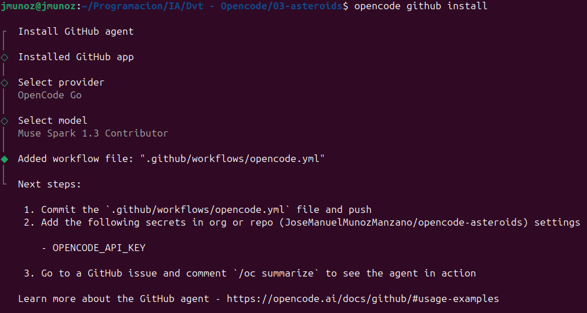
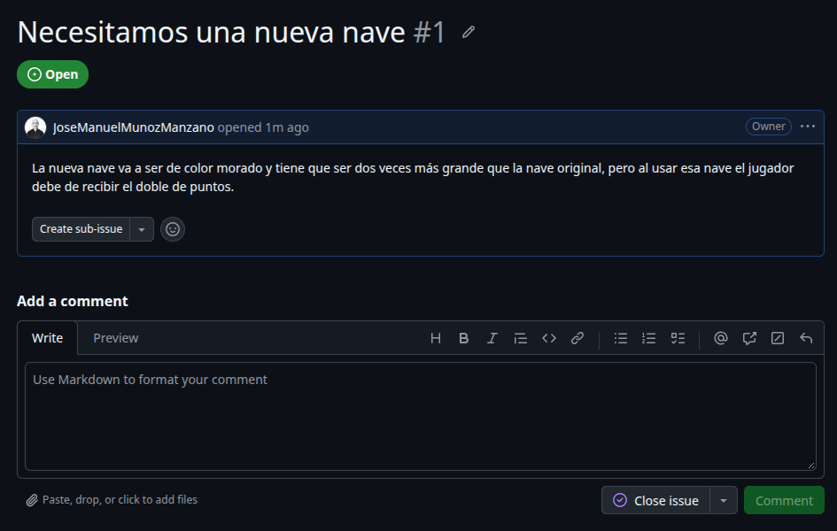
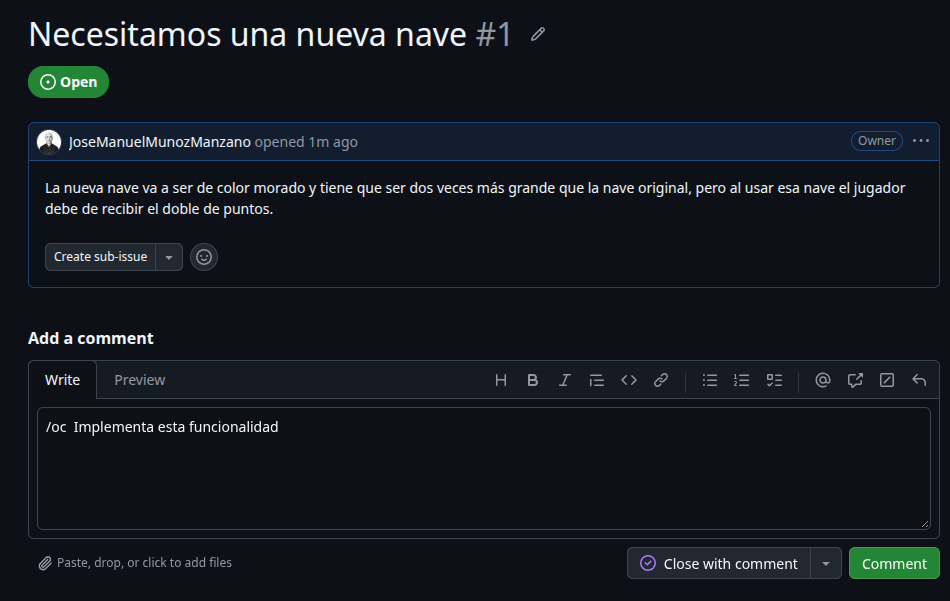
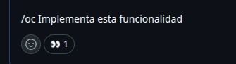
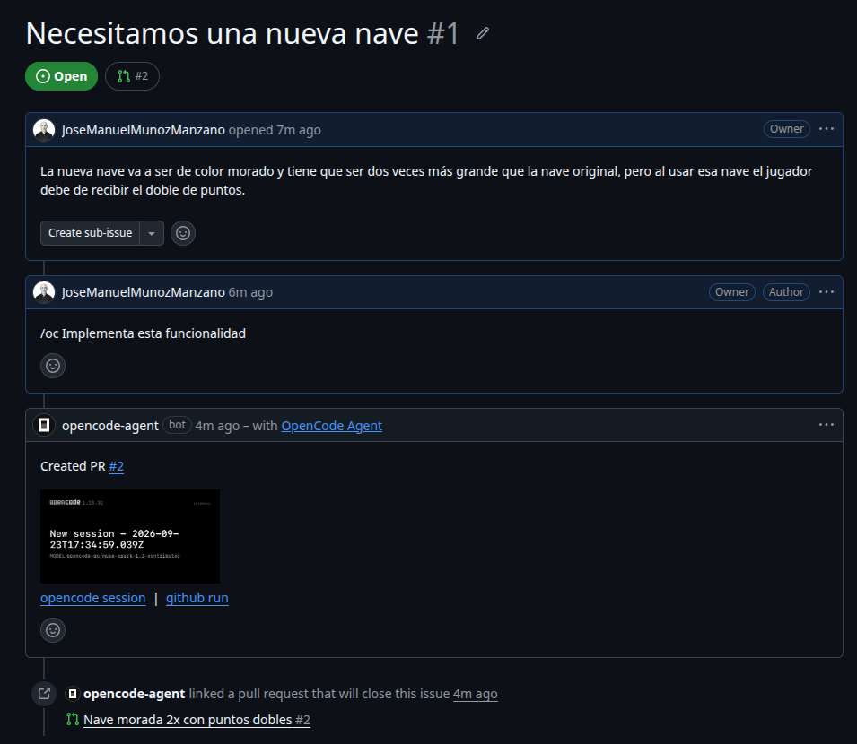
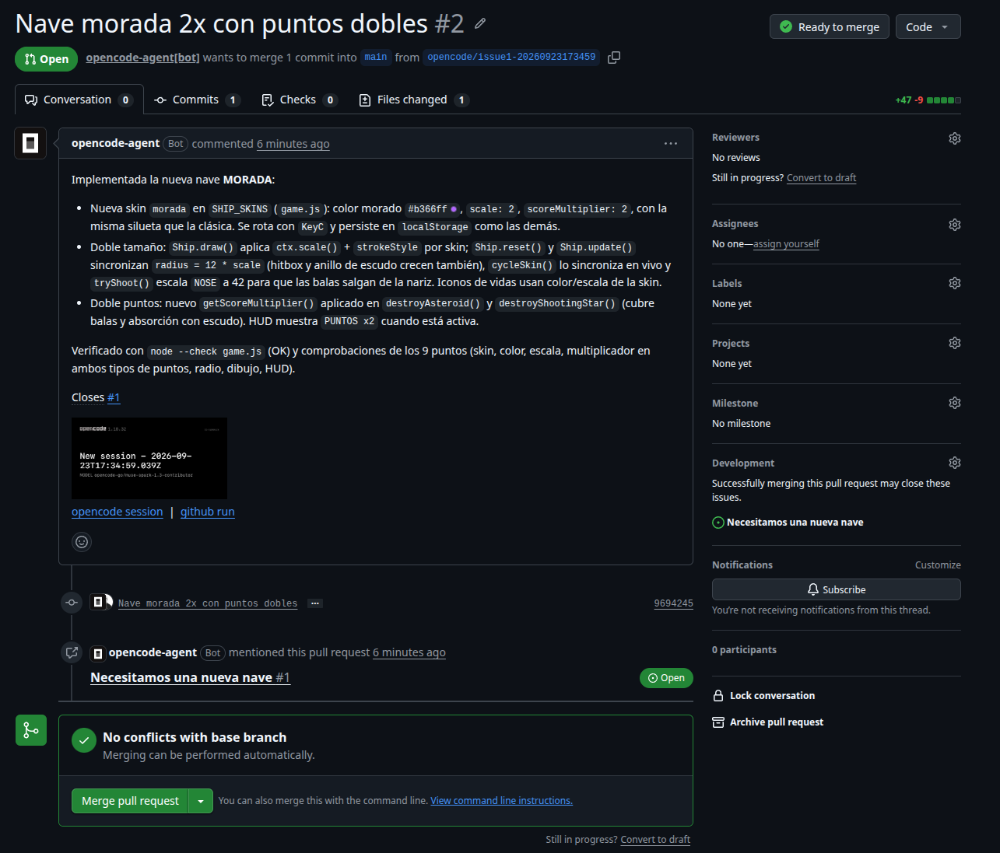
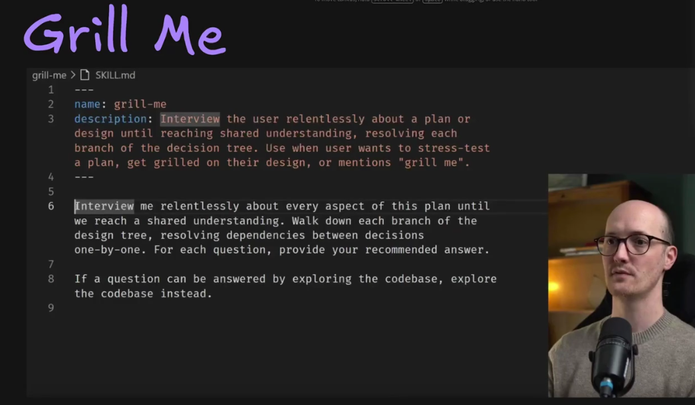

# Opencode: Guía completa para desarrolladores de software

Del curso: https://cursos.devtalles.com/courses/take/open-code-guia-completa/lessons/76158089-introduccion

## Introducción

Ver:

- [CheatSheet](./OpenCode-cheatsheet.pdf)
- Reglas de configuraciones de OpenCode: https://opencode.ai/docs/rules/

## OpenCode - Instalación y configuraciones

### Temas puntuales

Esta sección vamos a instalar OpenCode y a dejarlo configurado a tu gusto: conectaremos distintos proveedores de modelos, definiremos instrucciones globales para que el agente entienda tus proyectos y personalizaremos la interfaz de la terminal.

Temas puntuales:

- Instalación inicial de OpenCode y primeros pasos
- Configuración de proveedores de modelos (OpenAI, OpenCode Go y Ollama)
- Instrucciones globales del agente
- Personalización del TUI mediante tui.json

### OpenCode - Instalación Inicial

- Instalación: https://opencode.ai/docs/es/
  - Instalar con la instrucción `curl` y trabajar usando la terminal.
  - Para actualizar Opencode usaremos el comando: `opencode upgrade`
- Configuración: https://opencode.ai/docs/es/#configuraci%C3%B3n
  - Se recomienda usar OpenCode Zen: https://opencode.ai/docs/zen
  - Con `/connect` podemos añadir proveedores de modelos.

### Proveedores de modelos

Vamos a hacer una instalación de proveedores de modelos.

Lo primero es crearnos una carpeta donde va a trabajar OpenCode. En mi caso esta se va a llamar `01-demo`.

- Abrimos una terminal.
- Accedemos a la carpeta de trabajo `01-demo`.
- Ejecutamos el comando `opencode`.
- Se abre el TUI (Terminal User Interface)
  - Podemos configurar el tema que se visualiza usando el comando `/themes`.

- Para conectarnos a distintos proveedores usaremos el comando `/connect`.
  - De la lista que aparece seleccionamos `OpenCode Zen` (o `OpenCode Go` si estamos suscritos).
- Nos aparece un enlace y nos va a pedir una API Key.
  - Pulsamos en el enlace que aparece (Ctrl + Click del ratón)
  - Se abre una web y pulsamos en `Empieza con Zen`.
  - Veremos los modelos de Zen.
    - En la parte izquierda veremos la opción `Go`. Estos si son modelos (multimodales) de pago, pero son muy buenos y no es nada caro. Son los modelos chinos.
  - Pulsamos en `Claves API`.
  - Creamos una API Key dándole un nombre.
- El código de la API lo pegamos en OpenCode y pulsamos Intro.
  - Si tenemos la suscripción `OpenCode Go`, esta key también nos vale.
- Aparecen los modelos Zen (o Go si estamos suscritos) para seleccionar uno.
- También aparecerán los modelos si escribimos el comando `/models`.
- Del proveedor OpenCode Zen, seleccionamos, por ejemplo, el modelo `Big Pickle` gratuito (no es multimodal, es decir, si se le pasa una imagen no puede analizarla).
  - Para ver si funciona escribimos `ping`. Lo normal es que responda `pong`.
  - Esto es típico para medir velocidad de conexiones.
- Si vemos el consumo, veremos que hemos usado un 7% del contexto solo para un `ping - pong`. Esto es porque además de nuestro prompt y la respuesta del modelo, también se envían MCPs conectados, Skills conectados, configuraciones locales, el archivo de `AGENTS.md`, el archivo de configuraciones globales de mi ordenador, MCPs globales, etc.
- Si nos molesta la ventana lateral de la derecha, pulsar `Ctrl+X` y luego `B`.
- Cuando terminemos un trabajo y queramos iniciar una nueva conversación, pulsar `Ctrl+X` y luego `N`, o el comando `/new`.
  - Con esto purgamos el contexto.
  - Tenemos que acostumbrarnos a hacer esto.

### Proveedor - Modelos de OpenAI

Los que tenemos una suscripción de OpenAI podemos usar ChatGpt en Opencode.

- Dentro de OpenCode escribir el comando `/connect`.
- Escribimos `OpenAI` en la barra de búsqueda.
  - Aparecerá `OpenAI (ChatGPT Plus/Pro or API key)`
  - Seleccionarlo y pulsar Intro.
  - Seleccionar `ChatGPT Pro/Plus (browser)` y pulsar Intro.
    - IMPORTANTE: NO USAR LA OPCIÓN DE API Key, porque tendrá un mayor consumo. Tenemos que usar nuestra suscripción.
  - Aparecerá un URL. Pulsando `Ctrl + click de ratón` se abrirá un navegador de ChatGPT.
    - Indicaremos usuario y contraseña y pulsaremos en Conectar.
    - Volvemos a OpenCode y ya lo tendremos autenticado.
  - Si escribimos el comando `/models` ahora aparecerán los modelos de ChatGPT.
- IMPORTANTE: NO ASOCIAR LA SUSCRIPCIÓN DE ANTHROPIC EN OPENCODE. Hay baneos.

### Proveedor - OpenCode Go

Esta clase es para las personas que quieren usar `OpenCode Go`. Es lo que yo voy a usar.

- Dentro de OpenCode escribir el comando `/connect`.
- Escribimos `OpenCode Go` en la barra de búsqueda.
- Nos aparecerá una URL y tenemos que informar una Key.
  - Pulsamos `Ctrl + click de ratón` en la URL. Se abrirá un navegador con la web de OpenCode Go.
    - A finales de julio de 2026, la suscripción vale $5 el primer mes, y luego $10.
    - La ventaja es que nos permite ejecutar modelos open-source chinos muy buenos.
    - Pulsamos en el botón de Suscribirse y nos lleva a otra pantalla donde indica que incluye la suscripción y otro botón `Suscribirse a Go` que hay que pulsar.
  - Una vez pagada la suscripción podremos generar la API Key, que copiaremos.
- Nos vamos a OpenCode y pegaremos la API Key, por lo que ya tendremos acceso a esos modelos.

### Proveedor - Modelos de Ollama

Ver documentación: https://ollama.com/

Hay muchas formas para conectar OpenCode con modelos gratuitos de Ollama.

- La forma más fácil es ejecutar: `ollama launch opencode --model qwen3.5:9b` donde `qwen3.5:9b` es un ejemplo de modelo que debará sustituirse por el que queramos ejecutar en OpenCode.

### Instrucciones globales

Vamos a ver donde guarda OpenCode su configuración a nivel global y de proyecto.

- Global
  - Config. Global: `~/.config/opencode/opencode.json`
  - Config. TUI Global: `~/.config/opencode/tui.json`
  - Reglas Globales: `~/.config/opencode/AGENTS.md`
  - Plugins/agentes personalizados: `~/.config/opencode/agents/` , `plugins/`, `skills/`, `themes/`, `tools/`
  - Compatibilidad con Claude Code (fallback si no existe AGENTS.md): `~/.claude/CLAUDE.md`
  - Skills de Claude: `~/.claude/skills/`
- Proyecto
  - Config: `./opencode.json`, `./opencode.jsonc`, o `.opencode/opencode.json`
  - Config. Tui: `tui.json`
  - Subdirectorios del proyecto: `.opencode/agents/`, `commands/`, `plugins/`, `skills/`, `tools/`, `themes/`
  - Instrucciones/reglas del proyecto (se commitea): `AGENTS.md`
  - Compatibilidad con Claude Code (fallback si no existe AGENTS.md): `CLAUDE.md`

Las configuraciones globales serán sobreescritas por las configuraciones del proyecto.

Vamos a hacer una configuracíon global:

Abrimos el archivo `~/.config/opencode/opencode.jsonc` y lo dejamos así:

```jsonc
{
  "$schema": "https://opencode.ai/config.json",
  "instructions": ["instructions.md"],
}
```

El archivo `instructions.md` lo creamos en la ruta `~/.config/opencode` con el siguiente contenido:

```md
Eres un agente de codificación experto en clean code.

- Responde de manera corta y concisa.
- Código en inglés (nombres de variables, funciones, clases, todo).
- Comentarios en español, solo cuando aporten valor.
- Prioriza simplicidad: código fácil de leer, funciones pequeñas, sin duplicación (DRY).
- Sigue principios SOLID donde aplique.
- Sin comentarios superfluos — el código debe ser auto-documentado en lo posible.
- Sin magia: evita expresiones crípticas, prefiere claridad.
- Buenas prácticas de seguridad cuando corresponda.
```

No es bueno sobrecargar estos archivos, ya que todo esto va en el contexto.

Ahora cerramos OpenCode y lo volvemos a abrir con el comando `opencode -c`.

El `-c` es para que restaure y cargue la última conversación que tengamos.

### Configuraciones TUI.json

TUI significa Terminal User Interface y es todo lo que vemos al ejecutar OpenCode.

Vamos a hacer una configuración global para que haga un sonido cuando termine o requiera intervención humana.

- Vamos a esta URL: https://opencode.ai/docs/tui/#configure
- Cogemos la parte dedicada a `attention`.
- Para crear automáticamente el archivo `tui.json` cambiar, por ejemplo, el tema en OpenCode.
  - Yo tuve que crearlo porque no me lo creó: `~/.config/opencode/tui.json`
  - Modificamos el archivo.

El contenido que he puesto es el siguiente:

```json
{
  "$schema": "https://opencode.ai/tui.json",
  "theme": "opencode",
  "attention": {
    "enabled": true,
    "notifications": true,
    "sound": true,
    "volume": 0.4,
    "sound_pack": "opencode.default"
  }
}
```

He salido de OpenCode y vuelto a entrar, he puesto un prompt y, cuando ha salido la respuesta, ha hecho un sonido como de unas burbujas.

Si no queremos esta configuración a nivel global, sino solo a nivel de proyecto, solo tenemos que llevarnos el archivo `tui.json` a la carpeta donde tenemos nuestro proyecto.

## OpenCode 101 - Primeros pasos

### Introducción

Vamos a familiarizarnos con la TUI (Terminal User Interface), que es la manera recomendada de trabajar en OpenCode.

Vamos a ver el contexto, qué viaja en el y como crece y se desborda. Como es que el mejor modelo de vanguardia, llegado un momento, empieza a dar respuestas más torpes y se le nota que no va bien.

Luego, vamos a trabajar en un pequeño proyecto para, como se ha indicado, familiarizarnos con la TUI. En concreto como movernos, sin GIT, avanzando y retrocediendo en el tiempo.

Vamos a ver la diferencia entre modelos, pero se deja claro desde ya que la IA potencia nuestro conocimiento. Si sabemos mucho de lo que queremos hacer, en general obtendremos mejores resultados.

### Temas puntuales

En esta sección vamos a dar nuestros primeros pasos con OpenCode, familiarizándonos con su interfaz de terminal y los comandos esenciales del día a día. Aprenderás cómo se comporta el contexto a medida que trabajas y cómo controlarlo para sacarle el máximo provecho, configurando tu proyecto con Agents.md y los patrones a ignorar.

Puntualmente veremos:

- Interfaz de terminal (TUI) y navegación básica
- Gestión del contexto: cómo crece y cómo controlarlo (`/compact`)
- Comandos esenciales: `/redo`, `/undo`, `/init`
- Configuración con `Agents.md` y patrones a ignorar
- Plan mode para implementar funcionalidades

### ¿Cómo crece el contexto?

Esta clase es muy importante, porque nos va a explicar por qué los modelos de IA empiezan a arrojar resultados raros e, independientemente de que sea el mejor prompt, el modelo no se encarrila a dar buenos resultados.

- Todos los modelos de IA son stateless, es decir, no tienen estado (memoria).
- Cuando se manda un prompt a un LLM, no se manda solo el prompt, se manda muchísima más información, a la que se le llama contexto.
- Cuando el LLM responde y nosotros volvemos a escribir otro prompt, en ese contexto se guarda, además de muchas otras cosas, el primer prompt, la respuesta del LLM y el nuevo prompt.
- La conversación hace que el contexto crezca muy rápidamente, de manera exponencial, ya que se manda el historial de toda la conversación (prompt + respuestas) más, como se ha comentado, muchas más cosas necesarias.

**Contexto por mensaje**

- System Prompt: Instrucciones base
  - La gente de OpenCode ponen un prompt inicial que gobierna el comportamiento general del modelo.
- System Tools: Definiciones, bash, grep, lectura...
- Memory Files: Agents.md, (Claude.md si no existe Agents.md), auto memory, MCPs, skills, ...
- MCP Tools: Definiciones de los mismos
- Custom Agents: Sub-Agentes personalizados

**¿Qué podemos controlar nosotros?**

- Tus mensajes: Cada prompt de la conversación
- Respuestas del modelo: Historial
- Contexto Adicional: Archivos leídos (pdfs, imágenes)
- Resultados de herramientas: Bash, tests...

Esto lo podemos purgar pulsando `Ctrl+X` y luego `N`, o usando el comando `/new`.

El objetivo es tener enfocado el modelo en la solución de nuestros problemas. Es decir, si terminamos una conversación, debemos purgar el contexto (lo que podemos controlar) y empezar un nuevo chat.

Igualmente, si estamos en una conversación donde el contexto crece mucho, pero necesitamos seguir en esa conversación porque seguimos sin tener el resultado final, se puede compactar el contexto pulsando `Ctrl+X` y luego `C` o usando el comando `/compact`.

**Zonas**

Usando Opencode, con el tema del contexto, aparece algo llamado Zonas. Tenemos que intentar mantener el modelo enfocado en lo que importa.

Todo modelo de IA sin importar cual sea ni cual sea su ventana de contexto funciona muy similar a lo siguiente:

```
Zona Inteligente  /  Zona Tonto

   Inteligente   40%   Tonto
```

Realmente, podemos decir que el punto importante de llenado del contexto está entre el 40% y el 60%. Cuando lleguemos a un 50% del contexto máximo, debemos pensar en compactar la conversación, porque las respuestas ya no van a ser tan buenas.

Hay muchas técnicas que podemos usar para evitar que el modelo caiga en la zona tonta. Uno muy interesante, ya configurado en OpenCode por defecto, es usar el patrón `Orquestador - Trabajador`.

Consiste en que nosotros tenemos nuestro modelo con el que estamos interactuando. Cuando le pedimos información, este modelo delega la tarea a sub-agentes especializados en tareas. Este sub-agente empezará a trabajar, pero solo manda al modelo orquestados el resultado. De esta forma, ahorramos muchísimo contexto de trabajo realizado por el modelo, ya que ese trabajo no lo hizo el, lo delegó al sub-agente, que tiene su propia ventana de contexto (que también debería quedar por debajo del 40% o 50%).

NOTA: Un sub-agente ya no delega en otro sub-agente.

### TUI - Terminal User Interface

Vamos a hacer un ejercicio con la idea de ir familiarizándonos con la TUI de OpenCode.

- Solo con el propósito de ir viendo que ficheros se van generando, abrir la carpeta `01-demo` en VSCode.
- Creamos un archivo llamado `index.html`
- Lo abrimos y usando el snippet `!` creará una estructura vacía. Añadimos un `h1` con el texto `Hello World`.
- Abrimos la terminal y accedemos a la carpeta `01-demo`.
- Ejecutamos el comando `opencode`.
  - Esto lanza la TUI.

Si pulsamos la tecla `Tab` cambiamos entre tipos de agentes. Tenemos:

- Agentes Primarios: Agentes que usamos para interacturar directamente con el LLM.
  - Build
  - Plan
- Agentes Secundarios o Sub-Agentes.

Si pulsamos la combinación de teclas `Ctrl+p` aparece una ventana con atajos.

Si escribimos un texto largo en el TUI, ¿cómo hacemos para borrar palabras completas o todo lo que hayamos escrito?

- Borrar palabras completas: Pulsar `Ctrl+W`.
- Borrar todo: Pulsar `Ctrl+U`.

Para hacer mención a un archivo en particular, escribiremos `@` y luego empezaremos a escribir el nombre del archivo (aparecerá su nombre). Pulsando la tecla `Tab` se informará todo el nombre del archivo.

Si escribimos el signo `!` entramos al modo Shell, es decir, los comandos que informemos se van a ejecutar por terminal, sin usar ningún modelo, y será parte del historial conversacional.

Si queremos salir del model Shell, solo tenemos que pulsar `Backspace`.

Una vez ejecutado algo en model Shell, podemos preguntar al modelo sobre esa información, ya que, como se ha comentado, forma parte del contexto.

### Comandos /redo y /undo

NOTA: Estos comandos no sustituyen Git.

Para que estos comandos `/redo` y `/undo` funcionen, necesitamos inicializar nuestro repositorio en esa carpeta (en una terminal normal, situados en esa carpeta, ejecutar `git init`).

Para que OpenCode sepa que tenemos un control de versiones en esa carpeta (si lo abrimos antes de crear dicho control de versiones), tenemos que recargarlo. Salimos pulsando `Ctrl+C` y volvemos a entrar.

- `/undo`: hecha para atrás las acciones realizadas por Opencode.
- `/redo`: hecha para adelante (si habíamos usado `/undo`, es decir, existe un historial de cambios) las acciones realizadas por Opencode.

### Comando /compact

El comando `/compact` es muy útil, pero hay que usarlo con precaución.

Define cual es el objetivo, las reglas que tiene que seguir, qué está en progreso y qué está terminado, decisiones importantes, etc., en un fichero Markdown interno de Opencode.

Por supuesto, al compactar el contexto, mucha información se pierde, y es el LLM quien decide qué es importante para dejar y qué se purga.

Cuando el contexto conversacional suba por encima del 45%, es un buen momento para usarlo, aunque todavía es mejor comenzar una nueva conversación (si es posible, es lo ideal).

### Comando /init - Agents.md

El comando `/init` sirve para que Opencode haga un prompt injection en nuestra terminal, y nos cree el archivo `AGENTS.md`.

Es útil tener un archivo `README.md` que explique qué tenemos (ver [README.md de index.html](./01-demo/README.md)) ANTES de ejecutar el comando `/init` de Opencode.

Esto es porque, aunque en el archivo adjuntado no tenemos la tecnología `Tailwind CSS` queremos que sea parte del contexto que va a crear.

El archivo `AGENTS.md` sirve para guiar al LLM que estemos usando en Opencode, y todo lo que definamos en ese archivo siempre irá en el contexto, así que lo que haya ahí tiene que estar muy bien afinado y compacto (no miles de líneas, que sobrecargaría el contexto).

Constantemente, tenemos que pedir a Opencode que actualice este archivo, no usando ya `/init`, sino pidiendo al modelo que, una vez hechas modificaciones a los fuentes, actualice `AGENTS.md`.

Obviamente, también podemos informar a mano cosas que nos interesen y no haya incluido el modelo, como reglas de estilos, etc.

También podemos tener otros archivos donde podemos mandar más información al LLM.

Por ejemplo, en `AGENTS.md` podemos indicar:

```Markdown
## Reglas de estilos

Más información sobre las reglas de estilos las pueden encontrar aquí @style-guide.md
```

Así evitamos enviar todo el fichero `style-guide.md` en cada conversación que hagamos, ya que el agente lo verificará solo si lo necesita.

### Patrones a ignorar

Vamos a ver los patrones a ignorar que vienen en Opencode: https://opencode.ai/docs/tools/#ignore-patterns

Es, básicamente, lo mismo que podemos usar en la sintaxis del fichero Git `.gitignore`, pero el archivo que necesita Opencode se llama `.ignore`.

El LLM no buscará en los ficheros indicados en `.ignore`.

Existe este fichero `.ignore` porque `.gitignore` hace que los archivos no estén en el control de versiones, pero es que si queremos que estén en nuestro control de versiones. Lo que no queremos es que el modelo trabaje con esos archivos en concreto.

### Plan mode: Implementar una funcionalidad

En esta clase vamos a implementar una funcionalidad que tenemos mencionada en `AGENTS.md`, que es instalar y trabajar con Tailwind CSS, aunque actualmente no hay nada de eso.

- Ejecutamos opencode y, pulsando la tecla `Tab` hasta llegar al modo `Plan`. Este modo sirve para pensar como hacer cosas antes de construirlas (modo `Build`).

Podemos tener dos modelos, uno para el modo `Plan` y otro para el modo `Build`. Esto se hace ejecutando, con el modo `Plan` activo, el comando `/models` y seleccionando un modelo. Ahora hacemos lo mismo con el modo `Build` activo. Entonces, cuando pulsemos `Tab` veremos que los distintos modos tienen modelos distintos.

Lo normal será que el modelo más fuerte lo tengamos para el modo `Plan` y un modelo menos fuerte para el modo `Build`.

Podemos poner un nombre (o renombrar) a una sesión pulsando `Ctrl+R`. Viendo la barra lateral pulsando `Ctrl+X` y luego `B`, veremos en la parte superior el nombre de la sesión.

Podemos cambiar a otra conversación pulsando `Ctrl+X` y luego `L` o con el comando `/sessions`.

Si salimos de opencode y queremos volver a la última conversación que teníamos, ejecutaremos `opencode -c`.

## Aplicación de consola

### Introducción

Vamos a hacer una aplicación de clima en consola, interactuando con nuestro agente.

No vamos a partir desde cero porque vamos a usar comandos iniciales antes de utilizar el agente. Esto es para establecer las bases iniciales de lo que necesito que mi programa tenga por defecto, como son archivos iniciales, configuraciones iniciales, el framework o tecnología que voy a utilizar, etc.

Una vez hecho esto, vamos a pedir al agente que empiece a crear funcionalidades.

La idea no es que cree una aplicación perfecta, sino que la cree de la mejor manera posible.

Durante esta sección veremos los problemas que surgen si no sabemos qué está pasando.

Una vez creada la aplicación, crearemos un Github Action para que automáticamente cree el `release tag` con los binarios basados en nuestro código fuente.

### Temas puntuales

En esta sección vamos a aprender a usar OpenCode en la práctica construyendo una Weather App de consola. Configuraremos el contexto del agente con Agents.md, planearemos y construiremos la aplicación guiando al agente, y la mejoraremos resolviendo tareas prácticas. Cerraremos con pruebas automáticas y un flujo de CI con GitHub Actions para builds y release tags.

Temas puntuales:

- Configuración del contexto del agente con Agents.md para guiar el desarrollo
- Planeación y construcción de una aplicación de consola real (Weather App) con OpenCode
- Flujo de trabajo iterativo con el agente: detectar problemas, proponer ideas y aplicar ajustes
- Pruebas automáticas para validar el comportamiento de la aplicación
- Integración continua con GitHub Actions: builds automatizados y release tags

### Inicio de proyecto - Weather App

Para hacer esta aplicación, como es pequeña y se hace muchas veces como ejemplo (el LLM sabe ya como hacerla), vamos a aplicar una técnica que luego NO seguiremos usando, llamada `one-shot prompt`.

Las aplicaciones las haremos, más adelante, con `spec-driven development`, pero primero aprenderemos los problemas que tiene el desarrollo con `one-shot prompts`.

- Crearemos una carpeta dentro del curso llamada `02-weather`.
- Abrimos la carpeta en VSCode.
- Creamos el archivo `README.md` que medio diga lo que queremos hacer, con el stack de tecnologías a usar.
  - El texto viene de: `https://gist.github.com/Klerith/be4c38d7d4e06e2c50725d8860e25b02`
- En una terminal accedemos a esa carpeta y:
  - Inicializamos el repositorio: `git init`
  - Inicializamos el proyecto: `bun init`
    - Genera muchas cosas, entre ellas un archivo `CLAUDE.md` (si estamos suscritos a Anthropic) que puede usar OpenCode si queremos (yo voy a trabajar con `AGENTS.md`). Pero esa información es relevante, ya que explica al agente como funciona Bun, así que vamos a cambiar el nombre del archivo (de nuevo, no haría falta) a `bun-instructions.md`. Como a mi no me ha generado el fichero, no hago nada.
  - Hacemos nuestro primer commit.
  - Ejecutamos `opencode`.

### Agents.md - Configuración inicial

Vamos a inicializar `AGENTS.md`, que será lo que use Opencode como una regla. Siempre estará leyendo ese archivo.

- Con OpenCode abierto y en modo `Build`, ejecutamos el comando `/init` para que inyecte nuestro prompt y genere el archivo `AGENTS.md`.
- Hacemos otro commit.

### Planear y construir la aplicación

Cuando vayamos a trabajar en un proyecto que requiera cierto pensamiento, usar primero el modo `Plan`.

En modo plan, le digo esto:

- Vamos a crear una aplicación del clima. Por favor, abócate al archivo @readme.md porque ahí está como quiero que luzca. También están las instrucciones de cómo obtener las coordenadas y cómo obtener el clima basado en esas coordenadas.

Puede que haga algunas preguntas, que tendremos que contestar.

Recordar que aquí no se construye nada, solo genera un plan que le permita al agente de construcción poder seguirlo.

Pasamos al modo `Build` pulsando la tecla `Tab` y le decimos a OpenCode:

- Sí, vamos a construir esta aplicación tal como está el plan.

Es probable que nos pida acceso para grabar algún archivo.

El problema de hacer programas de esta forma es que genera muchos archivos a la vez que luego tendremos que revisar. Es mucho mejor ir viendo los archivos de uno en uno y, si algo no nos parece bien, ir pidiéndole a la IA que lo vaya corrigiendo.

Tal como lo estamos haciendo, si le pedimos un cambio en un archivo, puede que modifique el comportamiento en muchas otras partes de nuestra aplicación.

Nosotros, como desarrolladores, tenemos la responsabilidad de ver cada fichero generado y leer los cambios que haya para comprender qué pasó.

Manualmente, en `package.json` creo estos scripts para ejecutar mi app:

```json
  "scripts": {
    "build": "bun build --compile index.ts --outfile weather",
    "start": "bun run index.ts",
    "dev": "bun run index.ts --watch"
  },
```

### Ideas, problemas y ajustes

Ejecutamos nuestra app: `bun dev`.

Vamos también a crear el binario si no lo hizo la IA: `bun run build`.

Estas son las notas de la revisión para este proyecto. Cada proyecto tendrá cosas distintas que revisar, ya que el resultado de la IA será distinto en cada caso.

```Markdown
# Revisión Weather CLI

- **Colores:** no hay ninguno; falta definir cyan (menú), amarillo (temp), verde/rojo (ok/error).
- **AGENTS.md:** dice que `index.ts` es stub, pero la app ya funciona — hay que actualizarlo.
- **Ciudades:** geocoding solo trae 1 resultado; nombres ambiguos pueden fallar.
- **Tests:** no existen; conviene al menos probar storage y las APIs con mocks.
- **Binario:** compila bien; revisar que `./weather` guarde datos en `~/.config/weather-cli/`.
- **Escalabilidad:** ¿qué tan fácil será expandir con nuevas funcionalidades?
- **Carga:** ¿hay estado de carga en las tareas asíncronas?
```

Por ejemplo, a mi si me hizo algunos tests, pero metió todo el fuente en `index.ts` y creo que estaría bien dividir la funcionalidad en distintos archivos.

Vamos a dejar esas notas de revisión en un archivo `ideas-revision.md`. Es muy buena idea ir dejando estos textos en artefactos (archivos que le sirven a la IA para tomar decisiones)

El chat que tenemos en OpenCode ya no va a ser necesario. Incluso si hay algo mal y hay que ajustarlo, eso sería en una nueva conversación. Pulsamos `Ctrl+X+N`.

### Mejorar la aplicación

En el terminal ejecutamos la app con el comando `bun dev`. Como en `package.json` ese script contiene `--watch`, cada cambio recargará la aplicación (a mi no me lo recarga)

Del artefacto `ideas-revisión.md` vamos a hacer los puntos Colores, AGENTS.md, ciudades y 7 day forecast.

Primero siempre en modo plan para ver qué va a modificar. Una vez estamos conformes con el plan de implementación, pasamos al modo build, y tras cada cambio, pulsamos `Ctrl+X N` para crear un nuevo contexto.

- De @ideas-revision.md haz el punto Colores y marca su check
- De @ideas-revision.md haz el punto AGENTS.md y marca su check
- De @ideas-revision.md haz el punto Ciudades y marca su check
- De @ideas-revision.md haz el punto 7 day forecast y marca su check

Al hacer peticiones a la IA, hay que tener en cuenta lo siguiente:

- No dar tareas gigantes a los agentes (constrúyeme un clon de Instagram no lo va a hacer bien)
- ¿Usamos ramas?
  - Hasta ahora no lo hemos hecho, pero siempre debemos trabajar en ramas.
  - Por ejemplo, para los colores: `git checkout -b 01-colors`
  - Y cuando terminemos y hagamos el commit, volvemos a la rama main `git checkout main` y unimos a la rama main `git merge 01-colors`
  - Borramos la rama `git branch -d 01-colors`.
- ¿Usamos pull requests?
- ¿Qué pasa si tras un nuevo feature, se rompió otra cosa?
- Si se hubiera hecho testing, ¿qué probaríamos?
  - No hay prisa por hacer el testing, porque no sabemos lo que va a implementarse. Es mejor hacerlo al final.
- Si el modelo instaló dependencias, ¿cuáles instaló? ¿Estuvimos de acuerdo?
- ¿Comprendemos el código, lo que hace y lo que no hace?
  - Usando el control de versiones podemos ver qué se cambió.

Estas preguntas NO son todo lo que tenemos que tener en cuenta cuando trabajamos con IA. Por eso, en las siguientes secciones vamos a trabajar de una manera más estructurada.

### Estructura de archivos

Esta es la estructura de archivos que queremos, para que la aplicación sea escalable, y que todavia no tenemos. Se le llama `screaming architecture` porque cada directorio "grita" que es lo que tiene dentro. También queremos evitar archivos gigantes.

```
## Estructura deseada

src/
├── actions/                # Acciones principales que puede ejecutar el usuario
│   ├── getWeather.ts       # Obtener clima actual de una ciudad
│   ├── addCity.ts          # Agregar una ciudad a la lista
│   ├── removeCity.ts       # Eliminar una ciudad
│   ├── setDefaultCity.ts   # Establecer la ciudad por defecto
│   ├── listCities.ts       # Listar todas las ciudades guardadas
│   └── ...                 # Otras acciones futuras
├── presentation/           # Todo lo relacionado con la interacción de consola/CLI
│   ├── menu.ts             # Renderizado del menú y manejo de selección de opciones
│   ├── output.ts           # Funciones para mostrar mensajes al usuario
│   ├── input.ts            # Funciones para capturar y validar inputs del usuario
│   └── ...                 # Otros componentes de presentación
├── storage/                # Capa para leer, escribir y gestionar datos locales
│   ├── citiesStorage.ts    # Persistencia de ciudades guardadas
│   ├── settingsStorage.ts  # Persistencia de configuración y preferencias
│   └── ...                 # Otros mecanismos de almacenamiento
├── types/                  # Tipos y contratos TypeScript usados globalmente
│   ├── City.ts             # Definición de tipo City
│   ├── Weather.ts          # Tipos para la respuesta del clima
│   ├── MenuOption.ts       # Tipo para las opciones del menú
│   └── ...                 # Otros tipos globales
├── api/                    # Integración con APIs externas (OpenMeteo, geocoding)
│   ├── geocoding.ts        # Lógica para obtener coordenadas de una ciudad
│   ├── weather.ts          # Lógica para obtener el clima actual y pronóstico
│   └── ...                 # Otros endpoints o utilidades API
├── utils/                  # Utilidades y helpers reutilizables
│   ├── format.ts           # Formateadores de datos (fechas, temperaturas, etc)
│   ├── constants.ts        # Constantes generales de la app
│   ├── colors.ts           # Definición y utilidades de colores para la consola
│   └── ...                 # Otros utilitarios
├── index.ts                # Punto de entrada principal de la app CLI
```

Creamos una carpeta `references` y dentro el archivo `file-system.md` con esta documentación de estructura de archivos.

Vamos a indicarle a la IA que utilice este archivo para modificar nuestro `src`.

- Creamos una rama `git checkout -b 01-file-system`
- Hacemos el commit del fichero `file-system.md`.
  - `git add . `
  - `git commit -m "Agregado fichero de estructura de archivos"`
- En Opencode iniciamos un contexto nuevo con `Ctrl+X N`.
- En modo Plan indicamos: `Necesito que hagamos una refactorización en nuestro proyecto y el source debe de lucir exactamente igual como te lo estoy dejando en el archivo de referencia @references/file-system.md. No olvides actualizar AGENTS.md`
- En modo Build indicamos que lo implemente.
- Probamos el programa: `bun dev`
- Revisamos los cambios que ha hecho el programa usando el control de versiones y/o viendo los ficheros directamente.
  - En este caso todos los ficheros son nuevos, así que vemos los ficheros.
  - Revisamos bien los fuentes.
- Hacemos el commit.
  - `git add . `
  - `git commit -m "Actualizado proyecto a nueva estructura de archivos"`
- Volvemos a rama main y hacemos el merge
  - `git checkout main`
  - `git merge 01-file-system`
- Confirmamos que el merge ha sido correcto y borramos la rama `01-file-system`
  - `git branch -d 01-file-system`

### Pruebas automáticas

Vamos a realizar el código de las pruebas automáticas.

La idea es que, cada vez que se haga una nueva feature, se lanzarán las pruebas automáticas y, si estas no pasan, el código no se pasa a producción.

- Creamos la carpeta `tests` en la raiz del proyecto.
- Abrimos Opencode
- En una terminal creamos una rama `git checkout -b 01-testing`
- En el modo Plan pedimos a Opencode: `Vamos a implementar todo el testing automático usando el mismo bun.js. No debemos construir la aplicación si el testing falla. Crea todo el testing dentro de la carpeta /tests y no olvides actualizar AGENTS.md`
  - Leer el plan generado.
- En el modo Build indicamos que lo implemente.
- Comprobamos si el código sigue funcionando ejecutando `bun run test`
  - Si no ha creado este script lo podemos crear nosotros en `package.json` indicando `"test": "bun test --isolate",`
  - Igualmente creamos en `package.json` el script `"test:watch": "bun test--isolate --watch",` y lo ejecutamos con `bun run test:watch`.
- Hacer un commit
  - `git add .`
  - `git commit -m "Hecho Testing"`
- Si hay algo que no nos acabe de gustar, inicializamos el contexto, pedimos cambios y vamos ejecutando el testing para ver si pasan todos los tests.
- Volvemos a rama main y hacemos el merge
  - `git checkout main`
  - `git merge 01-testing`
- Confirmamos que el merge ha sido correcto y borramos la rama `01-testing`
  - `git branch -d 01-testing`

### GitHub Actions - Build y Release Tags

- Vamos a `GitHub` y creamos un repositorio para alojar nuestro código fuente de esta sección.
- Creamos el repositorio `opencode-weather-app`.
  - Ver https://github.com/JoseManuelMunozManzano/opencode-weather-app
- Hacemos el push al repositorio de GitHub.
- Lo que queremos hacer es que, cada vez que hagamos un push al main se debe de crear un `release tag` con el binario (bun build), que permite hacer la descarga de los binarios basado en los Sistemas Operativos, entre otras cosas. Esto se hace creando una `Action`.
- En nuestro proyecto en local creamos, en la raiz, una carpeta `.github` y dentro otra carpeta `workflows`.
- La action es un archivo `.yml` que nos va a crear Opencode.
- Abrimos Opencode con un nuevo contexto.
- En modo Plan le pedimos `Necesito que creemos un GitHub Action, el cual tiene que crear un release tag de la última versión basada en el @package.json. También necesito que generes el binario dentro de esa release tag. Recuerda que mediante el comando bun run build se construye el binario. Recuerda actualizar AGENTS.md`
  - Recordar que hay que leer lo que vaya a hacer.
  - Como hace referencia a un GITHUB_TOKEN, le decimos `Realmente no deberías de ocupar ningún GITHUB_TOKEN. Todo lo deberías de poder hacer en github sin necesidad de servicios externos.`
- En modo Build le decimos que lo construya.
- Podemos ejecutar el testing `bun run test`.
- El archivo `/.github/workflows/release.yml` generado hay que probarlo. Para ello tenemos que hacer commit y luego subirlo a Github.
  - `git add .`
  - `git commit -m "Añadida versión 1.0.0 a package.json para release inicial"`
  - `git push`
- Nos vamos a GitHub y/o recargamos y debe aparecer un release tag o indicar algún error.
- Notar que los binarios del release tag no está firmado, es decir, es inseguro y, si queremos ejecutarlo, tendremos que indicar que confiamos en el desarrollador. Este no era el objetivo de esta clase.

## Worktrees y comandos personalizados

### Introducción

Vamos a usar Opencode de una manera un poco más avanzada.

Vamos a ver un problema. Cada vez que abrimos una nueva instancia de Opencode detonamos un nuevo agente, que puede tocar todo el repositorio y empezar a hacer modificaciones. Si necesitamos hacer dos implementaciones en paralelo, por ejemplo, desarrollar una nueva funcionalidad que sabemos que puede demorarse unos 30 minutos y, a la vez, seguir avanzando en otras tareas, ¿cómo lo hacemos? Si abrimos dos terminales se pueden pisar el trabajo, es decir, modificar ambos agentes el mismo archivo, colisionando entre sí y dando lugar a bucles infinitos de correcciones.

Esto lo soluciona Git usando `Worktrees`, es decir, esto NO es Opencode. Los worktrees permiten crear un subrepositorio, es decir, un clon de la rama donde estamos trabajando. En Opencode detonaremos un agente en ese worktree, que ya no colisionará en el trabajo de otro agente.

Esto lo vamos a hacer primero manualmente, así veremos las partes que son tediosas y que se pueden automatizar, y lo haremos basado en un comando personalizado. Con este comando podremos crear el worktree. Veremos donde están los comandos personalizados, como se configuran de manera global, etc.

A nivel de proyecto, vamos a hacer un juego de Asteroides usando todavía `one-shot prompts`.

Vamos a integrar Opencode con Github, para llevar todo esto un poco más allá. Dado un issue de Github podremos decirle a Opencode que lo revise, implemente la solución y demás. Esto nos va a crear un pull request. Vamos a ver como verificarlo, revisarlo e integrarlo en la rama principal.

Veremos también otro tipo de acciones que vamos a poder crear con ese mismo token. Por ejemplo, cada vez que se cree un issue, que Opencode haga cierto flujo sobre el.

Vamos a crear secretos, variables, etc.

### Temas puntuales

En esta sección vamos a aprender a trabajar con worktrees de Git para desarrollar en paralelo con OpenCode, crear comandos personalizados y conectar todo con GitHub.

Puntualmente veremos:

- Worktrees de Git, manual y automáticamente
- Proyecto práctico con múltiples ramas (Asteroids)
- Comandos personalizados en OpenCode
- Integración de OpenCode con GitHub
- Automatización de issues y cambios en la nube

### Inicio de proyecto - Asteroids

- Vamos a expandir un ejercicio pequeño ya existente aquí: https://github.com/DevTalles-corp/opencode-asteroids
  - Hacemos un `fork` de ese repositorio: https://github.com/JoseManuelMunozManzano/opencode-asteroids
  - Hacemos un clone de, ya, nuestro repositorio `git clone https://github.com/JoseManuelMunozManzano/opencode-asteroids.git`
  - Le cambio el nombre de la carpeta a `03-asteroids`
- Abrimos la carpeta en VSCode.
- Podemos ejecutar el juego pulsando doble click en `index.html`.
  - Las teclas direccionales sirven para mover la nave y la barra espaciadora dispara.
- No es un juego 100% perfecto, por ejemplo, cuando nos mata un asteroide, si antes hemos disparado, la bala queda ahí, pero es un buen punto de entrada.
- Ejecutamos `opencode` en esa carpeta.
  - En la rama main, ejecutamos directamente en modo build `/init` para que se cree `AGENTS.md`.
- Hacemos un commit.

- Inicializamos contexto con `Ctrl+X N`.
- Vamos a entrar al modo plan y le vamos a pedir que nos explique el proyecto, ya que no lo hemos hecho nosotros: `¿Cómo funciona este proyecto? ¿Me puedes dar un resumen general del mismo?`
- Tenemos que leerlo!!
- Además, lo suyo es leer el código para saber como lo hace.

### Añadir power-up - Velocidad

En Opencode, al pedirle que nos explicara el proyecto al agente, nos puede haber dicho algo parecido a esto: `README.md:7 menciona power-ups y estrella fugaz, pero esas funciones no están implementadas.`

Vamos a implementar la funcionalidad del power-up.

- En la terminal crearemos una nueva rama: `git checkout -b 01-powerup-velocidad`
- En Opencode, inicializamos contexto con `Ctrl+X N`.
- En modo plan, mandamos el siguiente prompt: `Agregamos un nuevo feature a nuestro juego, que es "Power Up". Se va a llamar "Velocidad" y va a permitir al personaje moverse el doble de rápido durante 5 segundos.`
- Revisar lo que va a hacer para ver si algo no nos cuadra.
- En modo build indicamos que lo implemente y que actualice `AGENTS.md`.
- Revisar lo que va desarrollando. Lo que no entendamos, le preguntamos qué es (en modo plan)
- En VSCode, en el control de versiones, comparamos lo que se ha cambiado.
- Comprobar que funciona.
- Hacemos commit.
- Volvemos a la rama main y hacemos el merge.
  - `git checkout main`
  - `git merge 01-powerup-velocidad`

### Estrella Fugaz

Vamos a implementar la funcionalidad de estrella fugaz.

- En la terminal crearemos una nueva rama: `git checkout -b 02-estrella-fugaz`
- En Opencode, inicializamos contexto con `Ctrl+X N`.
- En modo plan, mandamos el siguiente prompt: `Implementar un asteroide especial "estrella fugaz", que se mueve más rápido de lo normal pero desaparece con el tiempo.`
- Revisar lo que va a hacer para ver si algo no nos cuadra.
- En modo build indicamos que lo implemente y que actualice `AGENTS.md`.
- Revisar lo que va desarrollando. Lo que no entendamos, le preguntamos qué es (en modo plan)
- En VSCode, en el control de versiones, comparamos lo que se ha cambiado.
- Comprobar que funciona.
- Hacemos commit.
- Volvemos a la rama main y hacemos el merge.
  - `git checkout main`
  - `git merge 02-estrella-fugaz`

### Git - Worktrees manualmente

Si tenemos tres agentes porque necesitamos hacer tres features o modificaciones en paralelo, cada uno trabajando en una rama, ¿cómo podemos hacerlo sin que los agentes colisionen? Cuando hacemos el movimiento a una rama, todas las terminales van a apuntar a la misma rama.

Para solucionar este problema, usaremos `Worktrees`. Este es un tema de Git.

- En la carpeta del proyecto creamos el directorio `.worktrees/`
  - La añadimos a `.gitignore`
- Ejecutamos `git worktree add .worktrees/<nombre-del-worktree>`

- Ejecutamos en una terminal de VSCode:
  - `git worktree add .worktrees/01-triple-shot`
  - `git worktree add .worktrees/02-skins`
  - `git worktree add .worktrees/03-shield`
- Abrimos en total tres terminales de las normales y la movemos una al lado de la otra.
- En cada terminal ejecutamos
  - `cd .worktrees/01-triple-shot`
  - `cd .worktrees/02-skins`
  - `cd .worktrees/03-shield`
- Abrimos Opencode en cada una de las terminales, en modo plan. Veremos que en cada instancia de opencode aparece su worktree correspondiente. Es decir, no va a haber colisiones.
- Ahora necesitamos 3 features que implementaremos de manera simultánea. En cada instancia de Opencode escribimos una de estas features.
  - Implementemos un **triple shot**: Por 5 segundos, el personaje dispara 3 veces en línea recta.
  - Implementemos un **sistema de skins**: Poder cambiar la apariencia de la nave.
  - Implementemos un **escudo**: Un escudo que protege a la nave de los proyectiles enemigos.
- Revisar lo que va a hacer para ver si algo no nos cuadra.
- En modo build indicamos que lo implemente (en cada Opencode) y que actualice `AGENTS.md`.
- Revisar lo que va desarrollando. Lo que no entendamos, le preguntamos qué es (en modo plan)
- En VSCode, en la carpeta `.worktrees` podemos ver lo que ha hecho en cada directorio.
- Podemos ejecutar cada `index.html` de cada directorio de `.worktrees` para ver si funciona cada funcionalidad nueva.

Indicar que podemos tener ramas independientes por worktrees o tener worktrees específicos para una actividad.

Comando para ver los worktrees que tenemos: `git worktree list`.

### Unir worktrees

Sabemos que cualquiera de las implementaciones realizadas va a modificar el archivo `game.js`, por lo que a nivel Git (no Opencode) no vamos a poder evitar conflictos.

Vamos a usar Opencode para unir los worktrees, borrarlos y unificar todo en nuestro main.

- En cada una de las sesiones de Opencode, en modo build, indicamos `Haz un commit de los cambios`.
- Abrimos un nuevo Opencode que apunte al proyecto `03-asteroids`. Ahí estamos en la rama main. Como va a haber conflictos, vamos a crear una rama de trabajo intermedia.
  - En VSCode creamos una rama `git checkout -b 03-union-worktree`
- En modo plan le decimos `Necesito que unas los 3 worktrees que tenemos, el de skins, el de triple shot y el de shield. Una vez terminado no borres los worktrees, yo voy a hacer eso manualmente.`
- Revisar lo que va a hacer para ver si algo no nos cuadra.
- En modo build indicamos que lo implemente y que actualice `AGENTS.md`.
  - Va a corregir los conflictos de manera automática.
- Vemos los cambios realizados en vSCode.
- Probamos `index.js` de la raiz del proyecto.
- Una vez todo probado y funcionando, lo vamos a unir al main, pero ya en una terminal de VSCode.
  - `git checkout main`
  - `git merge 03-union-worktree`
- Hacemos el push a GitHub `git push`
- Una vez tenemos claro que no nos hacen falta más los worktrees, los borramos.
  - Los listamos con `git worktree list`
  - Los borramos
    - `git worktree remove .worktrees/01-triple-shot`
    - `git worktree remove .worktrees/02-skins`
    - `git worktree remove .worktrees/03-shield`
- Borramos todas las ramas (salvo main) que tenemos usando `git branch -d <nombre_rama>`

De todas formas, el proceso manual sería el siguiente:

- En cada worktree hacer `git add .` y `git commit -m "<mensaje>"`
- Crear una rama intermedia en git, acceder a ella y hacer el merge a esa rama intermedia.
- Una vez todos los conflictos estén resueltos, acceder a la rama main y hacer el merge ahí.

### Comandos personalizados

Todo lo que hemos visto de los worktrees en las dos clases anteriores es un proceso manual. Vamos a crear comandos personalizados para agilizar la creación y uso de los worktrees.

Los comandos de Opencode pueden encontrarse aquí: https://opencode.ai/docs/commands/

Para invocar un comando se escribe `/` seguido del comando. Por ejemplo: `/undo`. Después de ese comando podemos mandar argumentos separados por espacio.

Es recomendable, al crear comandos, no darles un nombre ya existente en Opencode, porque si no va a crear conflictos.

Podemos definir comandos personalizados a nivel global o a nivel de proyecto:

- A nivel de proyecto, en formato Markdown, en la carpeta`.opencode/commands/<nombre>.md`
- A nivel global actualizando el archivo de configuración `opencode.jsonc`

Es preferible trabajarlo con Markdown para no agregar demasiadas cosas en el archivo de configuración, pero al final es una cuestión de gustos.

Si se hace a nivel de proyecto y subimos los cambios, ese comando es compartido por todos los miembros del proyecto. Si se hace a nivel global ese comando es solo para nosotros, cosa que también puede tener sentido.

**Formas de crear los comandos**

- Podemos acceder a la web indicada en esta clase, copiar el código fuente en la carpeta `.opencode/`.
- También podemos crear los comandos usando la terminal. Abrimos Opencode en la carpeta del proyecto y en modo plan indicamos lo que queremos hacer para que Opencode nos ayude a crear ese comando.

**Ejemplo**

Vamos a crear un comando llamado `worktree` que nos ayude a automatizar el uso de los worktrees de Git.

- Abrimos Opencode en la carpeta del proyecto.
- En modo Plan indicamos:

```
Necesito crear un comando personalizado de OpenCode que corra a nivel local. Que se ejecute /worktree. Lo que necesito que haga es simplemente el siguiente comando:

git worktree add .worktrees/<nombre-del-worktree>`

Ten presente que vas a recibir un argumento y ese argumento puede o no tener espacios. Necesito que lo analices y le pongas el nombre del worktree que está basado en el contexto que te estoy dando.

No hagas nada más. No te cambies de directorio. No hagas nada adicional. Simplemente ejecuta el comando de la creación del Worktree.
```

- Si indica algo sobre tocar el archivo `~/.config` indicarle al modelo que recuerde que es un comando local.
- Revisar lo que va a hacer para ver si algo no nos cuadra.
- En modo build indicamos que lo implemente.
- Vemos los cambios realizados, asegurándonos de que sigue las reglas indicadas en la web indicada al cominzo del capítulo.
- Para que el comando funcione, tenemos que reiniciar Opencode. Esto puede que el agente lo mencione.
- Volvemos a ejecutar Opencode. Si ahora escribimos `/worktree` nos debe aparecer el comando.
  - Hacer la prueba: `/worktree skins globales de juego`.
  - Debe crear un worktree `skins-globales-de-juego`.
    - Verlo en la terminal con el comando `git worktree list`.
- Ahora lo borramos con el comando `git worktree remove .worktrees/skins-globales-de-juego`.
- Y borramos la rama `git branch -d skins-globales-de-juego`.

### GitHub - Integración con Opencode

Podemos integrar Opencode con GitHub para que, en teoría, podamos hacer lo mismo que hacemos en consola. Podemos hasta invocar agentes desde GitHub.

Documentación: https://opencode.ai/docs/github/

- Instalación: En una terminal normal, dentro del proyecto `03-asteroids`, ejecutar `opencode github install`



Vemos que nos pide crear un código secreto `OPENCODE_API_KEY`, y además, veremos en nuestro proyecto que se ha creado la carpeta `.github/workflows/opencode.yml`. Ese fichero son las acciones, es decir, nuestro GitHub Action.

El `OPENCODE_API_KEY` lo configuramos en nuestro repositorio de GitHub, en Settings, luego Secrets and variables y luego Actions. Seleccionamos `New repository secret` y ahí indicamos `OPENCODE_API_KEY` y su valor, que en mi caso lo cojo de Opencode Go.

Ahora tenemos que subir nuestros cambios al repositorio, porque ahí va nuestra acción.

Con esto, ya podemos trabajar con Opencode desde Github, es decir, tenemos un asistente que está pendiente de este repositorio.

### Opencode + GitHub - Realizar cambios en la nube

En esta clase vamos a utilizar la integración de Opencode con Github.

- Vamos a crear un issue en nuestro repositorio.
  - Si no aparece para crear issues, ir a Settings, General y marcar la casilla para permitir issues.



- Esta tarea se la puedo delegar a Opencode y, en el comentario, indico a opencode que implemente la funcionalidad.



- Pulsamos `Comment`.
- La acción se detona por haber mencionado `/oc`, que es lo mismo que indicar `/opencode`, pero esta acción no arranca instantaneamente. Cuando veamos unos ojos, significa que una acción (Opencode en este caso) está verificando el issue.



- Podemos ir al menú Actions para ver como va trabajando y podemos pulsar para verlo.
- Luego, he vuelto a Issues y he visto que había creado un Pull Request



- Seleccionamos el numeral 2 y veremos todo el pull request.



- IMPORTANTE: NO LO UNIMOS AL MAIN
- Tenemos que aprobarlo antes de hacer el merge.
  - Pulsamos el botón de copiar al portapapeles el nombre de la rama (la segunda línea de la imagen)
  - En VSCode, donde estamos con nuestro proyecto, abrimos una terminal y ejecutamos: `git fetch` y luego `git switch opencode/issue1-20260923173459`
  - Ejecutamos index.html y jugamos, pulsando la tecla C hasta que aparezca la nave morada.
  - Una vez vemos que funciona bien, volvemos a main `git checkout main`
- De nuevo en GitHub, volvemos al pull request y lo revisamos y comentamos lo necesario.
- Hacemos el merge.
- Elminamos la rama.
- Pulsamos en Code y veremos que en main tenemos las modificaciones.
- Pulsamos en Issues y veremos que ya no aparece en Open, sino en Closed.
- En VSCode, en la terminal, en nuestra rama main, ejecutar `git pull`

### Opencode + GitHub - Instrucción personalizada + privilegios

Una vez instalamos la integración de Opencode con GitHub, podemos realizar muchas acciones, como hacer que intervenga en pull requests, disparar agentes y hacer diferentes acciones, siempre que tenga acceso un GitHub Action.

Vamos a crear un Issue con el titulo `Hay un problema en la pantalla` y el texto `Tenemos que hacer el juego más grande.`

El problema es que no tenemos label, el texto es muy ambiguo, no hay nadie asignado a ese issue, puede que requiramos cierta estructura en la creación de un issue y esta no se está respetando.

Vamos a crear una acción personalizada para que, cuando alguien cree un issue, me lo formatee, le ponga labels, le de más contexto al texto que escribió la persona que generó el issue.

Para esto, vamos a crear un nuevo fichero `issue-triage.yml` de la siguiente manera:

- Abrimos una terminal que apunte a nuestra carpeta de trabajo `03-asteroids` y ejecutamos `opencode`.
- Esto en la rama main, no hace falta crearse una rama.
- En modo Plan escribimos `Necesito que cada vez que se cree un issue se formatee, se pongan las etiquetas (labels) y también hay que mantener lo que sea que la persona escribió tal cual está, pero a la vez añadir cierta información que puede ser relevante a la hora de revisar los "issues". En pocas palabras, lo que necesito que hagamos es un nuevo "github action".`
- En modo Build indicamos que lo ejecute.
- Una vez construido, hacemos commit y push a GitHub.

Esto que hemos hecho tiene un problema. Lo normal será que, al formatear el Issue, Opencode nos pregunte algo o nos pida permiso para algo (proceso de verificación), pero como esto es un proceso automatizado, no vamos a responder nada. Esto se puede corregir.

- En GitHub, completamos el Issue que creaos anteriormente, para que no estorbe.
- Creamos un nuevo Issue con título `Ocupamos incrementar el tamaño de la pantalla` y la descripción `Vamos a duplicar el tamaño de nuestro juego`.
- La idea es que Opencode lea esta issue, determine cuáles pueden ser los labels y nos redacte de una mejor manera este issue.
- Si vamos a la pestaña de Actions, veremos que la acción se está ejecutando. Puede que no haya que verificar nada.
- En mi caso terminó correctamente y vuelvo a la pestaña Issue donde veo que me ha añadido un comentario, pero no ha creado labels como tales.

**Corregir problema de proceso de verificación**

En nuestro proyecto, en la raiz, crear el archivo `opencode.json` con el siguiente código:

```json
{
  "$schema": "https://opencode.ai/config.json",
  "permission": {
    "external_directory": {
      "/tmp/**": "allow"
    },
    "bash": "allow"
  }
}
```

Aquí lo que estamos diciendo es que va a tener permiso para poder trabajar con el directorio externo `"/tmp/**"`, y permitimos el comando `bash` a ese directorio.

Tenemos que hacer un commit y un push a GitHub y hacer de nuevo una prueba de issue.

## Spec Driven Development / Design

### Introducción

Vamos a empezar a aprender Spec Driven Development, el cual nos va a ayudar a crear artefactos, que son los `specs` o archivos de especificación, que van a ser usados después para guiar inteligencias artificiales, para que los agentes sepan qué tienen que hacer, como evaluarlos y como asegurarse de que funcionan. También nos van a servir para poder crear habilidades.

Tendremos dos clases de explicación para comprender bien que es Spec Driven Development, para qué sirve, como funciona, como está estructurado un archivo de especificación...

Instaleremos unas skills, con el objetivo de que nos ayude a que no sea tan tediosa la creación de esos archivos de especificación y luego los vamos a utilizar para implementarlos.

Vamos también a aprender como trabajar basado en un pull request en un repositorio de GitHub.

Esta sección es muy importante porque a partir de aquí vamos a seguir trabajando con Spec Driven Development.

### Temas puntuales

En esta sección, vamos a aprender sobre la metodología Spec Driven Development / Design (SDD) y cómo aplicarla en un proyecto real, construyendo paso a paso las mecánicas de un juego estilo Pac-Man con la ayuda de agentes y skills.

Puntualmente veremos:

- Fundamentos y consideraciones del SDD
- Agent Skills: instalación y preparación
- Creación de specs e implementación
- Flujo con Git y pull requests
- Tareas prácticas de corrección

### Metodología SDD - Exposición

Vamos a explicar qué es Spec Driven Development (o Spec Driven Design), como funciona, y para qué sirve.

Indicar que esta no es la única metodología existente para generar archivos de especificación, pero es importante comprender que hay que crear un artefacto, conocidos como archivos de especificación, porque sirven para la toma de decisiones, entrenar agentes y usarlo para respaldo y documentación.

**Spec Driven Development/Design**

Metodología en la que primero se escribe una especificación detallada y estructurada de lo que debe hacer el software.

Y a partir de esa "spec" se genera o guía la implementación, en lugar de saltar directamente a escribir código.

Sería como un mega-prompt con todo lo que queremos que incluya, lo que no queremos que incluya, con guías.

**Procedimiento spec-driven**

Fase humana - Definir que construir.

1. Describir
   1.1 El problema, no la solución. Es decir, no indicamos en ningún momento qué debe hacer el modelo, sino el problema que tenemos.
2. Plan Mode
   2.1 Opencode propone, no edita
3. Refinar
   3.1 Decisiones, no sugerencias, es decir, aquí tenemos que tener claras las cosas, son decisiones. Por ejemplo, indicar que se va a usar Firebase para tal cosa.

- ¿Lo tenemos ya claro?
  - Si es que no volvemos al punto 1 (o al 2) para ir refinando el problema. Lo normal es hacer 2-3 iteraciones hasta que se apruebe.
- Si lo tenemos claro, damos el trabajo.

Entramos en una fase de ejecución donde:

4. Guardar
   4.1 `specs/NN-feature.md` donde NN es 01, 02... Por ejemplo: `specs/auth/NN-feature.md`, `specs/products/NN-feature.md`, `specs/RRHH/NN-feature.md`.
   4.2 Lo importante es dejar algún tipo de documento que sirva para rastrear esa especificación.
5. Ejecutar
   5.1 Cada archivo de especificación debe ejecutarse paso a paso, con el objetivo de que cada uno de esos pasos deje la aplicación funcional.
   5.2 Cada paso será un commit. Si algo sale mal en un paso, debemos poder volver atrás e intentarlo de nuevo.
6. Revisar
   6.1 Diff por paso, comprobar.

**Reglas que casi nadie sigue :D**

- En el paso 1 describe el problema, deja que tus LLMs propongan la solución.
- En el paso 3 da decisiones concretas, no "creo que...", "tal vez sería bueno..." Si hacemos esto, las decisiones importantes las tomará el LLM, no nosotros.
- En el paso 5 pide pausas entre fases del plan; revisa diffs pequeños.
  - Es mejor ir comprendiendo pequeños bloques de código en lugar de tratar de leer 5000 líneas de golpe.
- Si a mitad del 5 quieres cambiar algo, vuelves al 2. NO IMPROVISES.
  - Es decir, pasaremos de la fase de ejecución a la de planeación, refinamos lo necesario actualizando el archivo de especificación.

### Consideraciones sobre el SDD

Vamos a hablar sobre la anatomía de un spec útil. También vamos a hablar sobre cuando vale la pena crear un spec (un archivo de especificación) o si es mejor crear un prompt directo (one-shot prompt). Y, de nuevo, dejar claro que esta no es la única metodología que existe.

**Anatomía de un spec útil**

Si tu spec no tiene las seis secciones, probablemente no es suficiente para guiar la ejecución.

1. Objetivo en una frase: Si no cabe en una frase, la feature es demasiado grande. Divídela en más etapas antes de escribir nada más. Cada etapa tendrá su archivo de especificación.
2. Alcance - lo que entra y lo que NO entra: El "no entra" es tan importante como el entra. Sin él, los límites son borrosos y aparece Scope Creep (ampliación incontrolada del alcance).
3. Modelo de datos: Estructuras y nombres concretos. Es decir, así van a lucir nuestras interfaces, así nuestras clases... Si estamos trabajando en un proyecto que usa arquitectura hexagonal tiene que tener estos archivos... Es como va a estar estructurado ese código nuevo en cuanto a los modelos de datos. Es la sección que más se cita después en otros specs y skills.
4. Plan de implementación ordenado: Pasos secuenciales numerados. Empezaremos con instalaciones, luego configuraciones, luego implementaciones y así sucesivamente. Cada paso deja el sistema en estado funcional- nada de a medias.
5. Criterios de aceptación: Checklist de booleanos verificables. "Que funcione bien" no es un criterio. "Recargar preserva scores" sí.
6. Decisiones tomadas y descartadas: Lo que consideraste y por qué elegiste lo que elegiste. Esto es oro dentro de tres meses cuando alguien pregunte "¿por qué?".

De nuevo, si tu spec no tiene las seis secciones, probablemente no es suficiente para guiar la ejecución.

**Cuándo si y cuándo no usar specs**

Es una decisión importante, porque determina si vas a vivir el método como apoyo o como dictadura, ya que lleva tiempo crear un spec.

- Sí - escribe un spec
  - Tocará más de dos archivos.
  - Decisiones caras de revertir.
    - esquemas, formatos, APIs públicas.
  - Lo vas a olvidar en una semana.
  - Más de una sesión de OpenCode.
  - Hay un contrato que otros artefactos van a reutilizar.
    - skills, agentes, otros specs
  - La feature te da pereza de planear porque es compleja.
    - Señal de que la necesita.

- No - usa un prompt directo
  - Bug fixes puntuales y pequeños.
    - Un botón que está mal. Si hago click en este botón se mueve la pantalla...
  - Refactorizaciones mecánicas, como renombrar un archivo, o mover archivos.
  - Experimentos exploratorios.
    - Descubres la decisión, no la ejecutas.
  - Cabe en un prompt y se entiende a la primera.
  - Tareas únicas que no se repiten.
  - La feature te aburre planearla porque es algo rápido.
    - Señal de que no la necesita.

Esto es una guía, pero cada problema es único y eso es lo que realmente determinará si necesita o no un spec.

**Recomendación**

Si te tienta abrir Plan Mode, probablemente lo necesites.

Si la feature te aburre planearla, probablemente no.

Al final del día, serán juzgados por el código que inserta el AI y aprueban. Si es algo importante, probablemente lo necesite.

**Spec + Skills + Agentes**

- Spec
  - El que y el por qué - decisiones de diseño y contratos. Humano-legible, vige en git, persiste entre sesiones.
  - Ejemplo: `specs/02-powerups.md` define el contrato.

Se apoya en

- Skill
  - El cómo repetible - flujo de trabajo invocable con `/comando`. Humano-legible, vive en `.agents/skills/`.
  - Ejemplo: `/new-powerup` lee el spec y crea un módulo conforme.

Es usado por

- Agentes
  - Usar skills, tomar referencias, leer códigos, specs y comprender cómo seguir implementando funcionalidades.

**Otras metodologías**

No solo existe Spec Driven Development. Otro ejemplo de metodología es `Grill Me`, de Matt Pocock, que se popularizó mucho. Matt la creó porque decía que a él no le funcionaba Spec Driven Development.

La idea es decirle a la IA que nos bombardee exhaustivamente con preguntar para obtener toda la información que necesita para desarrollar la tarea.



Lo más importante es que, al final, se quede plasmado en algún lugar lo que nosotros necesitamos hacer, ya que, con ese conocimiento creado, podemos entrenar agentes, crear habilidades, comandos, etc.

### Agent Skills - Introducción

Las skills permiten a Opencode reutilizar instrucciones. Es un prompt injection que le permite a nuestro agente saber como queremos que haga las cosaas. Usualmente se pueden crear skills o comandos cuando hay una tarea repetitiva que siempre tenemos que estar explicando a la IA como funciona.

La diferencia entre un comando y una skill es muy sutil. Un comando lo puede invocar un humano, mientras que la skill es para que un agente de IA sepa qué hacer con algo. Por supuesto, un agente también puede invocar un comando.

Los lugares oficiales para crearlas son:

- Configuración del proyecto: `.opencode/skills/<name>/SKILL.md`
- Configuración global: `~/.config/opencode/skills/<name>/SKILL.md`

Documentación: https://opencode.ai/docs/skills/

Vamos a ver como funcionan las skills en Opencode.

- Creamos una carpeta `04-mis-skills`.
- La abrimos en VSCode.
- Creamos un archivo `README.md` con el texto `## Este es un repositorio para aprender sobre SKILLS.md`.
- Abrimos una terminal que apunte a nuestra carpeta y ejecutamos `opencode`.
- No hace falta ejecutar el `/init` porque este es un proyecto explorativo sobre los `agent skills`.
- Imaginemos que hablamos mucho de Pokemon con nuestro agente.
  - Web: https://pokeapi.co/
  - Siempre acabo preguntando el nombre o las habilidades de un Pokemon.
  - Podemos crear una skill que vaya a la web y, usando su API, me devuelva información de ese Pokemon.
- En modo Plan vamos a crear un skill para probar, y luego vamos a instalar otras externas.
  - Le decimos

  ```
  Necesito que me ayudes a crear una skill que sirva para tomar la información de los Pokémon cuando yo lo necesite. Si menciono algo de Pokémon puedes usar esta habilidad.

  La habilidad necesita ir a buscar la información del Pokémon a esta API: https://pokeapi.co/api/v2/pokemon/ditto

  También funciona de la siguiente manera.
  https://pokeapi.co/api/v2/pokemon/1

  Puedo mandar el nombre o puedo mandar el ID del Pokémon.

  Cualquier tema de conversación sobre algún Pokémon debe consultarla para poderme responder de manera apropiada.

  Ayúdame a crear esta skill.
  ```

- Entramos al modo Build y le pedimos que cree la skill.
- Me ha creado el archivo `.opencode/skills/pokemon-info/SKILL.md` y tenemos que revisarlo.
- Tenemos que recargar. Para eso tenemos que salir de Opencode y volver a entrar ejecutando `opencode -c` para volver a nuestra conversación. De ahí cogemos la ruta donde creó la skill.
- Creamos un nuevo contexto `Ctrl+X N`
- En modo Build le pedimos `Consulta de prueba con Pikachu devolvió correctamente todos los campos (stats, tipos, habilidades, sprite, cry)` y el agente nos responde que la Skill funciona bien.
- Creamos un nuevo contexto y preguntamos en modo Build `Estoy pensando en hacer algún tipo de información o pantalla con el Pokémon número 4`
  - Vemos que usa la skill, me trae bien la información del Pokemon y me pregunta que formato quiero, si pantalla detalle, lista...
- Lo dejamos aquí, ya que solo queremos usar la skill.

### Preparación de proyecto - Instalación de skills

De la clase descargamos el proyecto `05-open-pacman`, que es el proyecto con el que vamos a trabajar.

Partimos de un proyecto creado para tener un punto de inicio. Más adelante crearemos un proyecto desde cero.

- Abrimos VSCode y dejamos caer la carpeta `05-open-pacman`.
- Ejecutamos `src/index.html` con doble click.
  - El juego tiene ciertos problemas que vamos a corregir usando Spec Driven Development.
- Abrimos una terminal y accedemos al proyecto. Ejecutamos `opencode`.
- En modo Plan le pedimos que nos explique como funciona el proyecto.
- Salimos de Opencode.

Hay una set de skills contruidos por Fernando Herrera con el objetivo de implementar y mantener el Spec Driven Development de una manera lo más apegada posible a las explicaciones dadas en estas clases.

Documentación: https://www.skills.sh/klerith/fernando-skills

Tenemos las siguientes skills:

- spec: Para poder definir los archivos de especificación. No los implementa, solo los define.
- spec-impl: Implementa los archivos de especificación.
  - Hay que tener cierto cuidado porque crea ramas automáticamente. La idea es crear una rama y trabajar la implementación siguiendo los pasos recomendados del Spec Driven Development.

- Para hacer la instalación, copiamos el comando que se indica en la web: `npx skills add klerith/fernando-skills`.
- En una terminal situado en la raiz de nuestro proyecto, ejecutamos ese comando.
  - Instalamos las dos skills.
  - Aparece un seleccionable para agentes adicionales. No seleccionamos ninguno.
  - Ante la pregunta `Installation scope` seleccionar `Project`.
- Una vez instalado, tendremos las carpetas `.agents/skills/spec` y `.agents/skills/spec-impl`
- Ejecutamos `git init` y hacemos commit.
- Ejecutamos de nuevo opencode. y ejecutamos en modo Build `/init` para comenzar a crear el archivo `AGENTS.md`. Recordar que se analiza el proyecto y las dependencias que hay, y que tenemos que estar actualizando este archivo constantemente.
  - Esperamos que en ese archivo aparezcan referencias a las skills instaladas.
  - Leemos este fichero `AGENTS.md` por si hubiera algo fuera de lo normal.
- Volvemos a hacer un commit.
- Creamos un contexto nuevo con `Ctrl+X N`.

### Bloquear rama principal

Esto no es obligatorio, pero es una buena práctica.

- Vamos a GitHub y creamos un repositorio público.
  - Para poder bloquear la rama el repositorio debe ser público o, si es privado, tener una cuenta de pago.
  - La idea es trabajar usando pull request, protegiendo así nuestra rama main.
- Usamos los comandos que nos da GitHub para subir los commits de Git al repositorio de GitHub.
- Para bloquear los push a la rama main, en GitHub vamos a `Settings/Branches` y seleccionamos `Add classic branch protection rule`. En `Branch name pattern` indicamos `main` y seleccionamos `Require a pull request before merging`.
  - Como no hay más personas que estén trabajando en el repositorio, deseleccionamos `Require approvals`.
  - Seleccionamos `Require status checks to pass before merging`.
  - Seleccionamos `Do not allow bypassing the above settings`.
  - Pulsamos el botón `Create`.
- Si ahora intentamos hacer un cambio en la rama main, en Git me va a dejar, per cuando haga el push a GitHub, no me va a dejar, y me va a indicar que cualquier cambio debe hacerse a través de un pull request.
- Entonces, lo que tenemos que hacer es crearnos una rama `git checkout -b 01-temp`, hacemos ahí los commits y subimos con `git push` a GitHub.
- En GitHub vamos a la rama subida y ahí aparecerá un botón `Compare & pull request` o también podemos pulsar la pestañá `Pull requests`.
  - Veremos un check verde de que se puede unir y podemos añadir un comentario.
  - Pulsamos el botón `Create pull request`.
  - Aparecerán datos del merge que se quiere hacer.
  - Pulsamos el botón `Merge pull request` y luego el botón `Confirm merge`.
  - Cuando termina, como no vamos a ocupar más la rama, pulsamos el botón `Delete branch`.
- Volvemos a nuestra terminal y volvemos a nuestra rama main `git checkout main`.
  - Traemos el main de GitHub con `git pull`.
  - Borramos la rama con `git branch -d 01-temp`.

### Spec - 4 fantasmas en juego

- Accedemos al proyecto `05-open-pacman` y ejecutamos `src/index.html`.
  - Vemos cierto problema, como que los fantasmas se quedan en su casa un buen rato, pero lo demás no está mal. Más bien faltan cosas, pero como punto inicial está bien.
  - Vamos a añádir las demás funcionalidades utilizando el Spec Driven Development.
- Abrimos una terminal, vamos a nuestro proyecto y ejecutamos `opencode`.
- En la skill `spec-impl` tenemos una configuración que nos permite crear ramas.
  - Es decir, usaremos la skill `spec` para planificar y cuando usemos la skill `spec-impl` para implementar la solución, automáticamente se creará una rama nueva.
- En modo plan y en la rama main escribimos lo siguiente: `/spec Ocupamos cuatro fantasmas en el juego de Pac-Man. Cada uno debe de tener su propia forma de actuar para que se comporte de forma diferente y uno de ellos debe de perseguir agresivamente a Pac-Man.`
  - Vemos como Opencode hace un prompt injection de la skill `spec`, para que podamos guiar la creación del archivo de especificación basado en todo ese texto.
  - Es bueno leer el texto de la skill `spec` y podemos añadir/eliminar lo que queramos.
  - El agente nos va a empezar a preguntar para poder hacer el juego lo más parecido a lo que nosotros tenemos en mente, pero que no dijimos en nuestro primer prompt. Nos va a hacer grupos de preguntas en vez de una por una.
- Una vez haya terminado el modo plan, nos pasamos al modo build e indicamos que se cree el spec.
  - El spec lo ha creado en la carpeta `specs`, y ha creado dos archivos. El archivo `.spec-config.yml` se crea porque lo dice la skill. Los que trabajen con `GitHub Workflows` tienen que cambiar el valor `AutoCreateBranch` a false. El archivo `01-four-ghost-personalities.md` está en estado de `Borrador` o `Draft`.
  - Ese spec tenemos que leerlo muy bien (ES NUESTRA RESPONSABILIDAD) y aprobarlo con el texto `Aprobado` o `Approved`.
  - Esto es realmente un mega-prompt. Si algo no nos parece bien, lo podemos cambiar a mano.
- En Opencode creamos una nueva ventana de contexto con `Ctrl+X N`.

De aquí en adelante vamos a trabajar con este archivo de especificación.

### Implementar - 4 fantasmas en juego

Vamos a implementar la feature.

- Abrimos una terminal, vamos a nuestro proyecto y ejecutamos `opencode`.
- En modo build le decimos: `/spec-impl @specs/01-four-ghost-personalities.md`
  - Esto va a fallar porque no hemos aprobado el spec.
- Accedemos a `specs/01-four-ghost-personalities.md` e indicamos `> **Status:** Aprobado`.
- Creamos una nueva ventana de contexto con `Ctrl+X N` y con la tecla direccional arriba volvemos a obtener el prompt anterior`.
  - Ahora si empieza a implementar.
  - Me va a indicar que tenemos cambios sin commitear (el Aprobado) y que el puede crear la rama (también puede detenerse todo y hacer la rama nosotros)
  - Me acaba creando la rama `spec-01-four-ghost-personalities`.
  - Me hará preguntas para confirmar si empieza con los ditintos pasos de implementación que tenemos en el spec. Cuando termine me dirá que revise los diffs antes de continuar con el siguiente paso.
  - Veo las diferencias y hago manualmente el commit.
    - En el mensaje del commit puede ponerse `Paso 1 de la implementación`...
  - Estoy viendo que en el código usa variables como `g`, que no sé que es. Le digo, en modo build `Por favor, no uses abreviaturas ni siglas, usa código limpio para saber qué significan las variables`. Esto también podemos indicarlo en `AGENTS.md` o en las configuraciones globales que siempre use código limpio y no abreviaturas ni siglas.
  - Una vez terminado, seguimos con los criterios de aceptación. Le podemos decir que los revise de manera automática. Es fácil que necesitemos usar un MCP como Playwright para que la IA pueda abrir un navegador y probarlo. Lo vamos a probar nosotros manualmente.
- Una vez confirmamos que está todo bien, volvemos a `specs/01-four-ghost-personalities.md` e indicamos `> **Status:** Implementado` y tenemos que hacer check en cada criterio de aceptación.

- Una cosa rara que he visto probando el juego es que el fantasma puede volver a entrar en casa. Eso no debería poder ser posible. Como es un bug importante, lo haremos en su propio spec.

### Unir mediante un pull request

Una vez tenemos todos los cambios guardados en los commits, en su propia rama creada con nombre basado en la especificación ejecutamos `git push --set-upstream origin spec-01-four-ghost-personalities`.

Vamos a GitHub y hacemos el pull request, luego el merge y borramos la rama. Esto ya vimos como hacerlo en una clase anterior.

Volvemos a Git, vamos a la rama main con `git checkout main` y hacemos `git pull` y borramos la rama en Git con el comando `git branch -d spec-01-four-ghost-personalities`.

### Spec - Corregir punto de salida de fantasmas

Voy a corregir, usando Spec Driven Development, el problema de que el fantasma vuelva a entrar en su corral.

- Accedemos al proyecto `05-open-pacman` y ejecutamos `src/index.html`.
- Abrimos una terminal, vamos a nuestro proyecto y ejecutamos `opencode`.
- En modo plan y en la rama main escribimos lo siguiente: `/spec Una vez el fantasma sale de su corral, no deben volver a entrar más, salvo cuando pacman muere, en cuyo caso empiezan en su corral de nuevo.`
- Una vez haya terminado el modo plan, nos pasamos al modo build e indicamos que se cree el spec.
  - El spec lo ha creado en la carpeta `specs`, con nombre `02-prevent-ghost-pen-reentry.md`,
  - Ese spec tenemos que leerlo muy bien (ES NUESTRA RESPONSABILIDAD) y aprobarlo con el texto `Aprobado` o `Approved`.
  - Indicamos `> **Status:** Aprobado`.
- En Opencode creamos una nueva ventana de contexto con `Ctrl+X N`.
- En modo build le decimos: `/spec-impl @specs/02-prevent-ghost-pen-reentry.md`
  - Crea ramas por mi, gracias al archivo `.spec-config.yml`, y a cada paso terminado yo miro qué ha hecho y hago commit manual.
  - En el mensaje del commit puede ponerse `Paso 1 de la implementación`...
- Le digo que no olvide actualizar `AGENTS.md`. Cuando lo haga, hago el commit.
- Unir mediante pull request.
  - Ejecuto `git push --set-upstream origin spec-02-prevent-ghost-pen-reentry`
  - Vamos a GitHub y hacemos el pull request, luego el merge y borramos la rama
  - Volvemos a Git, vamos a la rama main con `git checkout main` y hacemos `git pull` y borramos la rama en Git con el comando `git branch -d spec-02-prevent-ghost-pen-reentry`.
- En el archivo `specs/02-prevent-ghost-pen-reentry.md` Indicamos `> **Status:** Implementado` y tenemos que hacer check en cada criterio de aceptación.

### Spec - Power Pellets

Vamos a crear un spec para que la IA nos cree 4 power pellets, uno en cada esquina del tablero de juego.

- Accedemos al proyecto `05-open-pacman` y ejecutamos `src/index.html`.
- Abrimos una terminal, vamos a nuestro proyecto y ejecutamos `opencode`.
- En modo plan y en la rama main escribimos lo siguiente: `/spec Añade un power pellet en cada esquina del tablero de juego. Una vez pac-man lo come, cambia la imagen del fantasma a asustado y pac-man puede comerse los fantasmas. Si pac-man se come un fantasma, este volverá al corral y no podrá salir hasta pasados 10 segundos. El efecto del power pellet dura 10 segundos.`
- Una vez haya terminado el modo plan, nos pasamos al modo build e indicamos que se cree el spec.
  - El spec lo ha creado en la carpeta `specs`, con nombre `03-power-pellets-and-frightened-ghosts.md`,
  - Ese spec tenemos que leerlo muy bien (ES NUESTRA RESPONSABILIDAD) y aprobarlo con el texto `Aprobado` o `Approved`.
  - Indicamos `> **Status:** Aprobado`.
- En Opencode creamos una nueva ventana de contexto con `Ctrl+X N`.
- En modo build le decimos: `/spec-impl @0specs/3-power-pellets-and-frightened-ghosts.md`
  - Crea ramas por mi, gracias al archivo `.spec-config.yml`, y a cada paso terminado yo miro qué ha hecho y hago commit manual.
  - En el mensaje del commit puede ponerse `Paso 1 de la implementación`...
- Le digo que no olvide actualizar `AGENTS.md`. Cuando lo haga, hago el commit.
- Unir mediante pull request.
  - Ejecuto `git push --set-upstream origin spec-03-power-pellets-and-frightened-ghosts`
  - Vamos a GitHub y hacemos el pull request, luego el merge y borramos la rama
  - Volvemos a Git, vamos a la rama main con `git checkout main` y hacemos `git pull` y borramos la rama en Git con el comando `git branch -d spec-03-power-pellets-and-frightened-ghosts`.
- En el archivo `specs/3-power-pellets-and-frightened-ghosts.md` Indicamos `> **Status:** Implementado` y tenemos que hacer check en cada criterio de aceptación.

## MCPs y Agentes personalizados

### Introducción

En esta sección vamos a configurar servidores MCP y crear agentes personalizados.

- MCP: Los vamos a usar para dos superpoderes a nuestros agentes.
  - Instalaremos el MCP de Playwright, que le permitirá a nuestro agente poder tomar el control de un navegador web (Google Chrome) para abrirlo, hacer clicks, tomar screenshots que podremos comparar con distintos resultados y pedirle ajustes y que se pueda iterar a si mismo. Esta configuración primero la haremos de manera local.
  - También vamos a instalar el MCP de Context7 con su API key, de manera global. La idea es que cada vez que hagamos algo relacionado a Next.Js verifique la última documentación para ver como se hacen las cosas, por si ha cambiado algo desde la liberación del modelo.
- Agentes personalizados: Vamos a crear agentes personalizados.
  - Crearemos uno que, basado en nuestros archivos de especificación, nos ayude a evaluar todos los criterios de aceptación de nuestros artefactos de especificación, es decir, marcar el check. Esto lo teníamos que hacer a mano, con lo que, gracias a este agente personalizado, podemos cerrar el círculo del Spec Driven Development. Ahora, cuando todos los checks estén marcados, podemos marcar el artefacto como implementado.
  - Aprenderemos a ejecutar los agentes en otros contextos, específicamente en la parte de GitHub.

### Temas puntuales

En esta sección, vamos a aprender sobre cómo integrar MCPs (Model Context Protocol) y crear agentes personalizados dentro de OpenCode, aplicando todo lo aprendido directamente sobre el proyecto práctico OpenDayCare.

Puntualmente veremos:

- Configuración e integración de MCPs como Playwright y Context7
- Creación y uso de Skills personalizadas, incluyendo spec y spec-impl
- Metodología Spec Driven Development para definir specs antes de implementar
- Agentes personalizados en OpenCode, como el Spec Verifier, y criterios de aceptación automáticos
- Implementación práctica de features en OpenDayCare: HomePage, pantalla de niños y perfil

### Inicio de proyecto - OpenDayCare

Del curso bajamos un archivo que contiene dos carpetas, una `pantallas` con varios archivos `html` y otra `screenshots` con varios archivos `png`.

La idea es implementar una aplicación que nos sirva para un control de guardería, tanto para la parte del padre como para la parte que ofrece el servicio de guardería.

Las pantallas existentes se crearon usando Claude Design, que es de pago. Las alternativas son V0, Lovable, Google Stitch y Bolt.

El proyecto lo vamos a hacer usando Next.Js por la facilidad de tener conectado el backend y el frontend, pero lo que vamos a hacer funcionaría para cualquier tecnología.

Para crear el proyecto, abro una terminal en la carpeta del curso y uso el comando `npx create-next-app@latest open-daycare`. Una vez termina, renombro la carpeta a `06-open-daycare`.

En el terminal accedemos a esta carpeta y ejecutamos `npm run dev` para levantar el proyecto. Accedemos a la ruta que indica la ejecucíon y vemos si funciona.

Abro VSCode y me llevo la carpeta a el, para abrir en VSCode el proyecto.

Veremos que ya existe el archivo `AGENTS.md` con unas instrucciones específicas donde, como el equipo de Next.JS hace muchos cambios, se indican referencias a documentación nueva y actualizada, para que la usen los agentes de IA.

También existe un archivo `CLAUDE.md` que solo hace referencia a `AGENTS.md`.

En el proyecto creamos lo siguiente:

- Creamos en la raiz una carpeta `preferences` y ahí nos llevamos las carpetas `pantallas` y `screenshots` indicadas al principio de esta clase. Esto nos va a servir para que, cuando vayamos a crear algún tipo de pantalla, el agente tenga la referencia en el HTML. Igualmente, al agente le van a venir bien los screenshots.
- Antes de empezar, tenemos que actualizar `AGENTS.md` con los objetivos de nuestra aplicación, el patrón de desarrollo y metodología a seguir, que en este caso es Spec Driven Development.
  - También vamos a indicar qué MCPs vamos a utilizar. Recordar que los MCPs consumirán más contexto, así que menos es mejor.
  - También vamos a instalar las skills.

### MCP - Playwright
